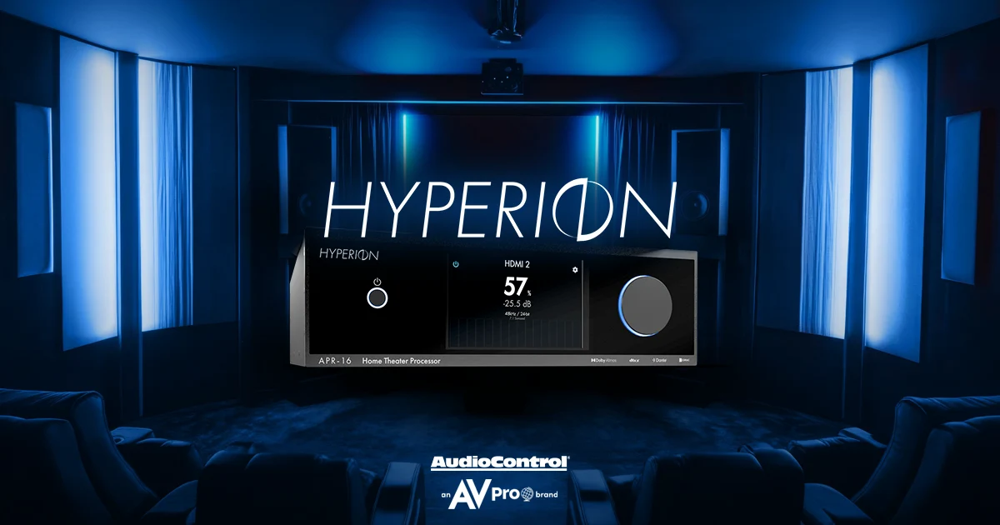
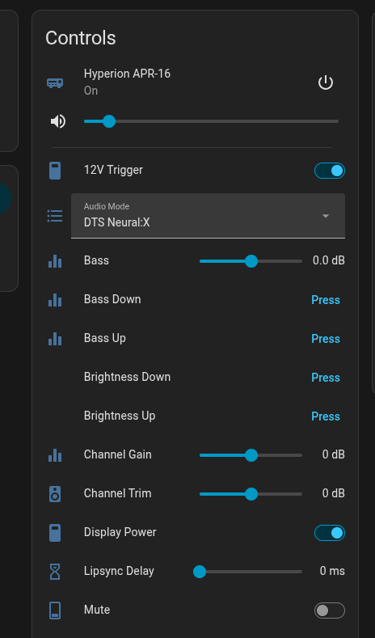
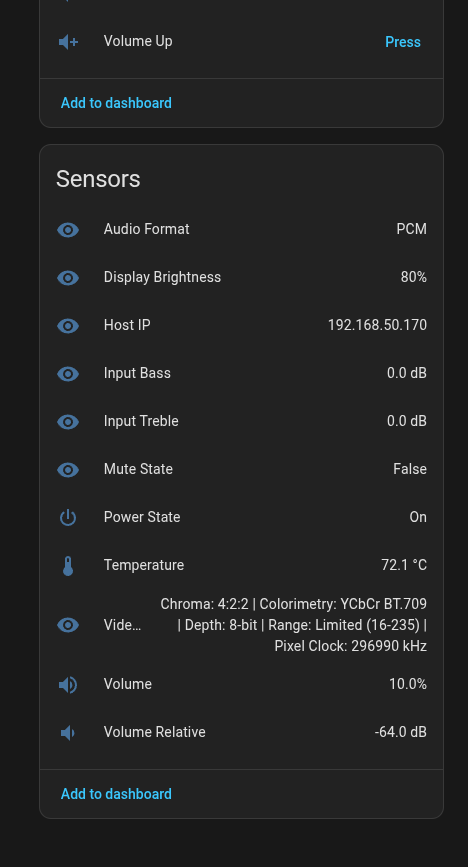
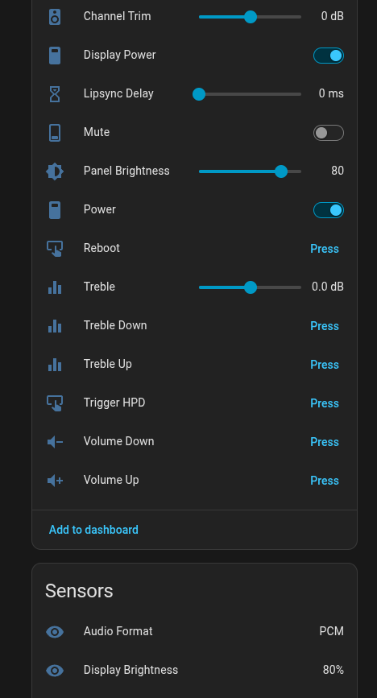
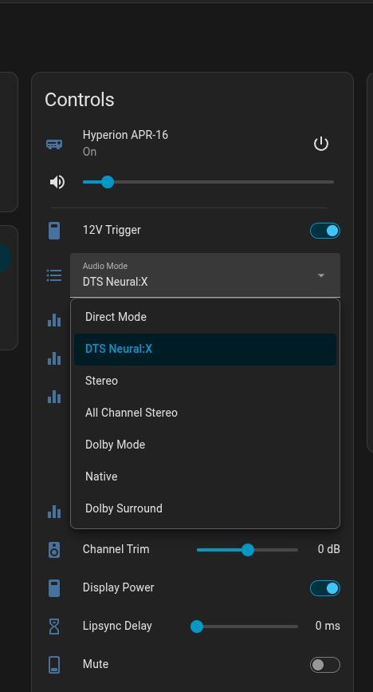
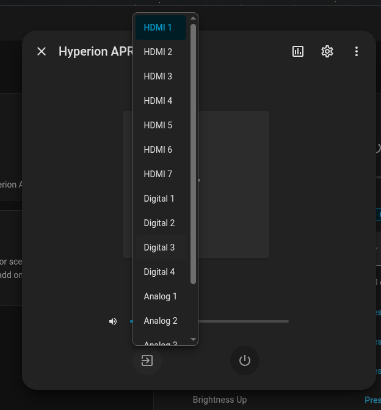

## Home Assistant integration for the AudioControl Hyperion Apr16

This repo provides a [Home
Assistant](https://www.home-assistant.io/) integration for the [Hyperion Apr-16](https://www.avproglobal.com/products/acp-hype-apr-16) Immersive Sound Pre-Amp Processor. This integration may be extended with a [Custom Lovelace Card](https://github.com/fattykidd/ha-hyperion-apr16-card)

## Installation

### Market Place (recommended)

1. Click **my** button above
2. Install
3. Restart Home Assistant
4. Go to **Settings → Devices & Services → Add Integration**, search for "Hyperion", and follow the config flow, entering your Apr16's IP address.
### or
1. Search Marketplace on your local Home Assistant for "Hyperion" or "AudioControl" 
2. Select **AudioControl Hyperion APR-16** from the list
3. Install
4. Restart Home Assistant
5. Go to **Settings → Devices & Services → Add Integration**, search for "Hyperion", and follow the config flow, entering your Apr16's IP address.

## Updating

**Via Marketplace:** Home Assistant will show an update notification when a new version is released; click **Update**, then restart Home Assistant.

## Features

Everything is grouped under one device, **AudioControl Hyperion APR-16**.

| Platform | What you get |
| --- | --- |
| **Media player** | Power, volume, mute and source selection. The source list uses the names you gave your inputs on the processor. |
| **Switches** | Power, Mute, Display Power, 12V Trigger, **Dirac Active** and **Loudness** |
| **Selects** | Audio Mode and **Dirac Filter Slot** (named after your slots) |
| **Numbers** | Panel Brightness, Bass, Treble, Channel Trim, Channel Gain and Lipsync Delay for the active input, plus **Maximum Volume** and **Power-On Volume** (listed under the device's configuration) |
| **Sensors** | Power State, Absolute Volume, Relative Volume (dB), Mute State, Audio Format, Video Signal, **Video Format**, **HDR Status**, Display Brightness, Temperature, Host IP, Input Bass, Input Treble and Active Dirac Slot |
| **Buttons** | Reboot, Trigger HPD, Bass / Treble / Brightness / Volume up and down, Dirac Enable / Disable and one button per Dirac slot |

### Live updates

The processor tells Home Assistant about changes as they happen, the same way its own web page works. Volume, mute, power, the active input, the Dirac slot and state, loudness and the video signal update within a fraction of a second, whether you change them in Home Assistant, on the processor's web page or from a remote.

Settings that are only available by asking the processor (temperature, panel brightness, the 12V trigger, bass and treble) are refreshed every 30 seconds, and straight away after you change one from Home Assistant. If live updates are not available (older firmware, or the processor is restarting) the integration falls back to asking every 5 seconds, so it keeps working either way.

## Requirements

* A Hyperion APR-16 reachable from Home Assistant on your network.
* Port **8080** (the REST interface) and port **80** (live updates, Dirac and loudness). If you filter traffic between Home Assistant and the processor, allow both.

## Troubleshooting

* **Loudness is unavailable:** your firmware does not offer it, or the processor has not reported it yet. It appears as soon as the processor does.
* **Changes made on the processor take a few seconds to appear for temperature, brightness or the trigger:** those are refreshed every 30 seconds. Volume, mute, input, Dirac, loudness and video are instant.
* **Warnings that a stream was lost:** the processor was unreachable or restarting. The integration reconnects by itself and carries on polling meanwhile.

## What You're Getting

 
 

## Acknowledgements and Attributions 

* **[Home Assistant](https://www.home-assistant.io/)** — For providing an incredible, extensible open-source home automation platform.
* **[AudioControl](https://www.audiocontrol.com/)** — For crafting phenomenal home theater processing hardware.
* **The Open-Source Community** — To all the unpaid developers and hobbyists whose passion and dedication make custom hardware integrations possible.
* **Gemini** — For architectural collaboration, troubleshooting, and code structure assistance throughout development.